# CalculatriceWS

TP2 : Mise en oeuvre de Jakarta XML Web Services

## Description

Application Java qui expose un service web **SOAP** (Jakarta XML Web Services / JAX-WS) permettant d'effectuer quatre opérations simples :

| Opération | Description |
|---|---|
| `somme(a, b)` | Retourne a + b |
| `soustraction(a, b)` | Retourne a - b |
| `multiplication(a, b)` | Retourne a * b |
| `division(a, b)` | Retourne a / b (SOAP Fault si b = 0) |

## Structure du projet

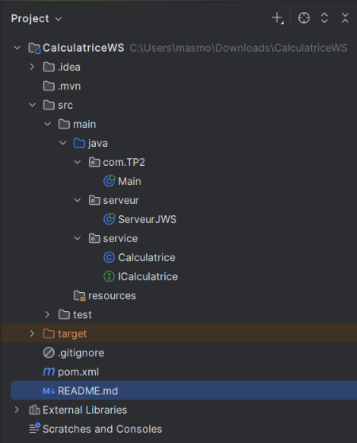

- `service/ICalculatrice.java` : interface du service (`@WebService`, `@WebMethod`, `@WebParam`)
- `service/Calculatrice.java` : implémentation métier
- `serveur/ServeurJWS.java` : publication du service (`Endpoint.publish`)

## Prérequis

- JDK 17 
- Maven (intégré)
- SoapUI pour les tests

## Lancement

1. Cloner le projet :
   ```
   git clone https://github.com/chachamasmoudi/CalculatriceWS.git
   ```
2. Ouvrir le projet dans IntelliJ et recharger Maven (*Reload Maven Project*).
3. Exécuter la classe `serveur.ServeurJWS` (clic droit, *Run*).
4. Le service est publié à l'adresse :
   ```
   http://localhost:8080/calculatrice
   ```
5. Le contrat WSDL est disponible à :
   ```
   http://localhost:8080/calculatrice?wsdl
   ```
   et le schéma XSD à :
   ```
   http://localhost:8080/calculatrice?xsd=1
   ```

## Test avec SoapUI

Pour tester le service, j'ai d'abord lancé `ServeurJWS`, puis j'ai créé un projet dans SoapUI :

1. *File > New SOAP Project*.
2. Dans *Initial WSDL*, saisir `http://localhost:8080/calculatrice?wsdl`.
3. SoapUI génère automatiquement une requête pour chaque opération (`somme`, `soustraction`, `multiplication`, `division`).
4. Dans chaque requête, je remplace les `?` par mes valeurs, puis je clique sur le bouton vert pour l'exécuter.

### 1. Opération somme

J'ai testé la somme avec a = 10 et b = 5. Le service retourne bien 15.0.

**Requête :**

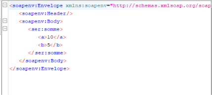

**Réponse :**

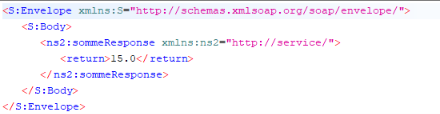


### 2. Opération soustraction

J'ai testé la soustraction avec a = 10 et b = 4. Le résultat obtenu est 6.0, ce qui est correct. L'ordre des paramètres compte ici : c'est a - b.

**Requête :**


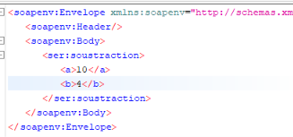


**Réponse :**


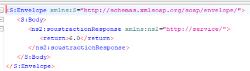

### 3. Opération multiplication

J'ai testé la multiplication avec a = 6 et b = 7. Le service retourne 42.0.

**Requête :**

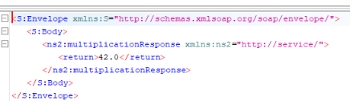

**Réponse :**

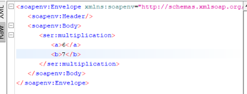


### 4. Opération division

J'ai testé la division avec a = 20 et b = 4. Le résultat est 5.0.

**Requête :**

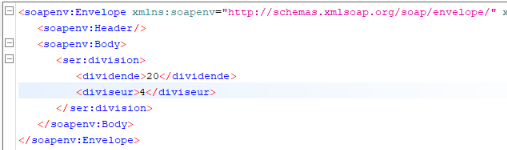

**Réponse :**

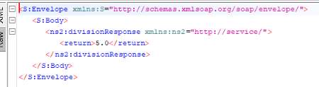

### 5. Division par zéro (cas d'erreur)

J'ai aussi voulu tester un cas particulier : la division par zéro (a = 10 et b = 0). Dans ma méthode `division`, je vérifie si b vaut 0 et je lève une exception `IllegalArgumentException`. JAX-WS transforme automatiquement cette exception en **SOAP Fault**, et SoapUI affiche le message d'erreur « Division par zéro impossible » au lieu d'un résultat.

**Requête :**

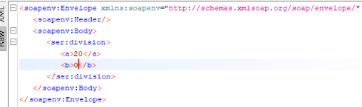

**Réponse (SOAP Fault) :**

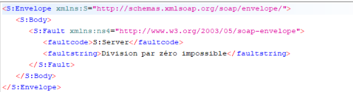

## Correspondance classe métier / contrat WSDL

En consultant le WSDL et le XSD générés, j'ai remarqué que chaque élément de ma classe Java correspond à un élément du contrat :

| Java | WSDL / XSD |
|---|---|
| Interface `ICalculatrice` | `portType` |
| Méthode `somme` | `operation` |
| Paramètres `@WebParam` | éléments du type complexe de la requête |
| Valeur de retour | élément `return` de la réponse |

## Conclusion

Dans ce TP, j'ai créé un service web SOAP avec Jakarta XML Web Services : configuration du projet Maven, écriture de la classe métier, ajout des annotations (`@WebService`, `@WebMethod`, `@WebParam`), publication avec `Endpoint.publish`, puis test des quatre opérations avec SoapUI. Les annotations permettent à JAX-WS de générer automatiquement le WSDL et le XSD, sans avoir à les écrire à la main.