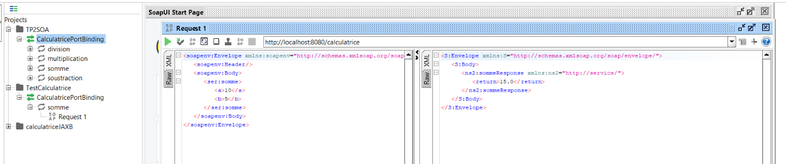

# CalculatriceWS

TP2 : Mise en oeuvre de Jakarta XML Web Services

## Description

Application Java qui expose un service web **SOAP** (Jakarta XML Web Services / JAX-WS) permettant d'effectuer quatre opérations simples :

| Opération | Description |
|---|---|
| `somme(a, b)` | Retourne a + b |
| `soustraction(a, b)` | Retourne a - b |
| `multiplication(a, b)` | Retourne a * b |
| `division(a, b)` | Retourne a / b (SOAP Fault si b = 0) |

## Structure du projet


- `service/ICalculatrice.java` : interface du service (`@WebService`, `@WebMethod`, `@WebParam`)
- `service/Calculatrice.java` : implémentation métier
- `serveur/ServeurJWS.java` : publication du service (`Endpoint.publish`)

## Prérequis

- JDK 17 (ou 11 minimum, adapter le `pom.xml`)
- Maven (intégré à IntelliJ)
- SoapUI pour les tests

## Lancement

1. Cloner le projet :
   ```
   git clone https://github.com/chachamasmoudi/CalculatriceWS.git
   ```
2. Ouvrir le projet dans IntelliJ et recharger Maven (*Reload Maven Project*).
3. Exécuter la classe `serveur.ServeurJWS` (clic droit, *Run*).
4. Le service est publié à l'adresse :
   ```
   http://localhost:8080/calculatrice
   ```
5. Le contrat WSDL est disponible à :
   ```
   http://localhost:8080/calculatrice?wsdl
   ```
   et le schéma XSD à :
   ```
   http://localhost:8080/calculatrice?xsd=1
   ```

## Test avec SoapUI

1. *File > New SOAP Project*.
2. Dans *Initial WSDL*, saisir `http://localhost:8080/calculatrice?wsdl`.
3. Ouvrir une opération (par exemple `somme`) puis sa *Request 1*.
4. Remplacer les `?` par des valeurs (a = 10, b = 5) 
5. Exécuter la requête (bouton vert) et vérifier la réponse (`return` = 15.0) :



## Correspondance classe métier / contrat WSDL

| Java | WSDL / XSD |
|---|---|
| Interface `ICalculatrice` | `portType` |
| Méthode `somme` | `operation` |
| Paramètres `@WebParam` | éléments du type complexe de la requête |
| Valeur de retour | élément `return` de la réponse |

## Auteur

Chama Smoudi, LSI3-GLSI, Faculté des Sciences de Sfax